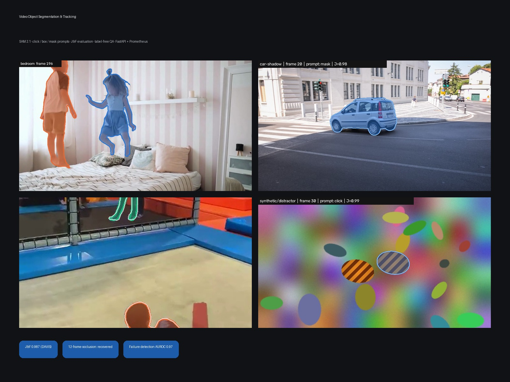
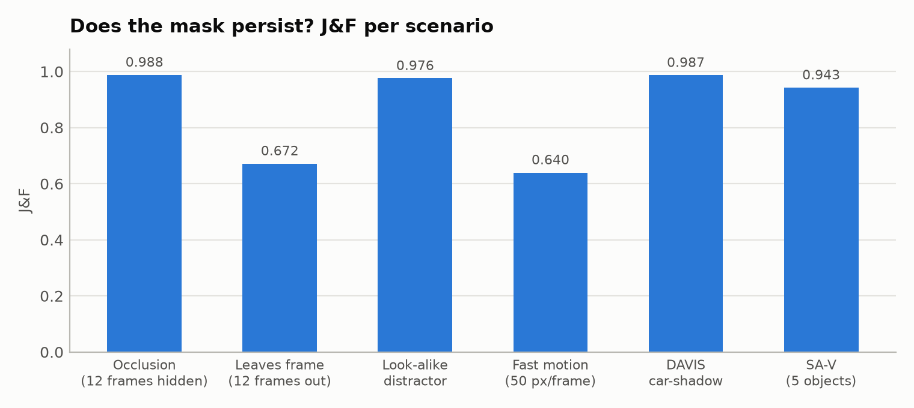
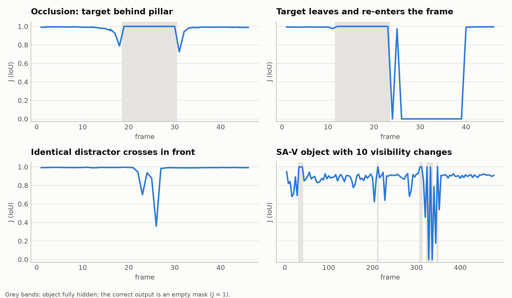
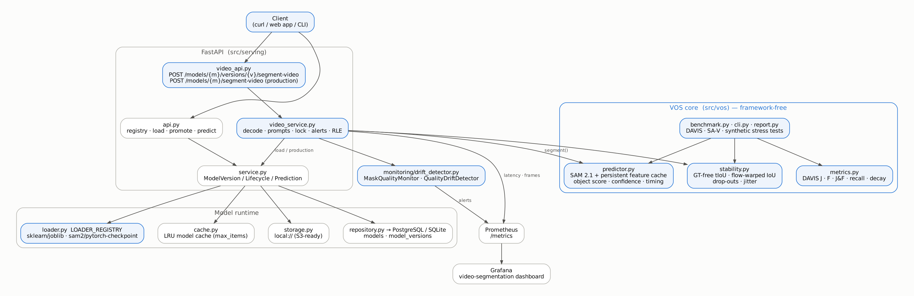

# SAM 2 Video Segmentation & Tracking Platform

> **Phase 1 question:** *can a segmentation mask be kept on an object across a whole video and how do you prove it?*
> This repo answers it with **SAM 2.1**, a DAVIS-standard evaluation harness, synthetic stress tests with exact ground truth, ground-truth-free quality monitoring, and a production serving layer (FastAPI · model registry · Prometheus · Grafana) inherited from the ML Model Serving Platform.


<p align="center"></p>

---

## What you get

| Deliverable | Where | Why a client cares |
|---|---|---|
| **AI rotoscoping CLI** — clicks/box in → alpha-matte PNGs + overlay MP4 + masks + stability report | `python -m src.vos.cli segment` | Replaces manual roto; output drops straight into Premiere / Resolve / After Effects |
| **Video segmentation API** — upload a clip + prompts, get per-frame COCO-RLE masks, stability metrics and quality alerts | `POST /models/{name}/segment-video` | Same model registry, versioning, promotion and rollback as any other model |
| **Evaluation harness** — DAVIS J, F, J&F, recall, *decay*; event metrics for occlusion, re-entry and distractors | `src/vos/metrics.py`, `benchmark.py` | Accuracy claims you can verify, per failure mode |
| **GT-free quality monitoring** — temporal IoU, optical-flow-warped IoU, drop-outs, SAM 2 object score → Prometheus alerts | `src/vos/stability.py`, `src/monitoring/drift_detector.py` | You know when tracking breaks in production, without labels |
| **Synthetic stress tests** with exact ground truth | `src/vos/synthetic.py` | Reproduces the hard cases (12-frame occlusion, look-alike distractor, exit/re-entry, 50 px/frame motion) |

---

## Phase-1 results (CPU, SAM 2.1 hiera-tiny)

Full tables, plots and per-frame data: [`results/phase1/REPORT.md`](results/phase1/REPORT.md) · engineering report & code review: [`docs/Phase1_Code_Review.docx`](docs/Phase1_Code_Review.docx)

**Answer: yes, with one specific exception.**

- **Accuracy:** J&F **0.987** on DAVIS car-shadow. Full mask, box, 3 clicks and **1 click** all give 0.987: for a salient object, user effort is one click.
- **Occlusion:** 12 fully hidden frames → empty mask on all 12 (SAM 2's object score goes negative), re-detected on the **first** visible frame. J&F 0.988.
- **Look-alike distractor:** an identical object crossing in front pulls up to 64 % of the mask for 1–2 frames; no identity switch. J&F 0.976.
- **The exception:** an object that **leaves the frame and returns rotated** is re-detected, then lost again for 14 frames while fully visible (object score just below 0), then recovered. J&F 0.672. This is the trigger for an automatic re-prompt hybrid (Phase 2) and what SAMURAI / DAM4SAM-style memory selection addresses.
- **Fast motion (50 px/frame, blur):** never lost (J recall 0.98), but masks cover the blur streak (F 0.56). Motion blur needs soft alpha (matting), not binary masks.
- **Real multi-object video (SA-V, 5 objects, 6 fps):** J&F 0.944; re-detected at each of 5 reappearances. The smallest object (0.35 % of the image) is the only one that drifts.
- **Label-free failure detection:** SAM 2's object-presence score flags frames with J < 0.5 at **AUROC 0.97** (32 failures in 988 frames).
- **Cost (2 vCPU, no GPU):** encoder ≈ 2.3 s/frame + ≈ 3.6 s per object per frame. Every-4th-frame processing lost nothing on smooth motion. The feature cache makes re-runs with new prompts ≈ 1.7× faster (one object) with bit-identical masks.

<!-- RESULTS:START -->
### All runs
| Sequence | Prompt | Stride | Frames | Obj | J&F | J | F | J-decay | ms/frame |
|---|---|---|---|---|---|---|---|---|---|
| car-shadow | mask | 1 | 40 | 1 | 0.987 | 0.976 | 0.998 | 0.013 | 2446 |
| car-shadow | box | 1 | 40 | 1 | 0.987 | 0.976 | 0.998 | 0.012 | 1220 |
| car-shadow | click | 1 | 40 | 1 | 0.987 | 0.976 | 0.997 | 0.011 | 1219 |
| car-shadow | click3 | 1 | 40 | 1 | 0.987 | 0.977 | 0.998 | 0.010 | 1222 |
| car-shadow | mask | 2 | 20 | 1 | 0.987 | 0.976 | 0.998 | 0.013 | 1117 |
| car-shadow | mask | 4 | 10 | 1 | 0.988 | 0.977 | 0.998 | 0.010 | 927 |
| synthetic/fast_motion | mask | 2 | 24 | 1 | 0.634 | 0.719 | 0.549 | 0.034 | 2282 |
| synthetic/fast_motion | mask | 4 | 12 | 1 | 0.693 | 0.754 | 0.632 | -0.007 | 980 |
| synthetic/occlusion | mask | 2 | 24 | 2 | 0.989 | 0.978 | 1.000 | -0.002 | 3477 |
| synthetic/occlusion | mask | 4 | 12 | 2 | 0.990 | 0.981 | 1.000 | 0.011 | 2031 |
| synthetic/occlusion | mask | 1 | 48 | 2 | 0.988 | 0.976 | 1.000 | -0.001 | 3149 |
| synthetic/exit_reentry | mask | 1 | 48 | 1 | 0.672 | 0.670 | 0.674 | 0.412 | 2453 |
| synthetic/fast_motion | mask | 1 | 48 | 1 | 0.640 | 0.718 | 0.562 | 0.020 | 2431 |
| synthetic/distractor | mask | 1 | 48 | 1 | 0.976 | 0.968 | 0.984 | 0.001 | 2355 |
| synthetic/distractor | click | 1 | 48 | 1 | 0.975 | 0.965 | 0.985 | -0.003 | 1286 |
| sav_000001 | mask | 4 | 121 | 5 | 0.943 | 0.917 | 0.969 | 0.045 | 6112 |

### Persistence events (synthetic stress tests, exact GT)
| Scenario | Hidden frames | Hidden-J | Re-detect delay | Lost again after re-detect | Max leakage |
|---|---|---|---|---|---|
| synthetic/occlusion (mask) | 12 | 1.00 | [0] | 0 | – |
| synthetic/exit_reentry (mask) | 12 | 1.00 | [1] | 14 | – |
| synthetic/fast_motion (mask) | 0 | – | – | 0 | – |
| synthetic/distractor (mask) | 0 | – | – | 0 | 64 % |
| synthetic/distractor (click) | 0 | – | – | 0 | 63 % |

### Can failures be detected without labels?
| GT-free signal | Spearman ρ with J | AUROC (detect J < 0.5) |
|---|---|---|
| object_score | 0.47 | 0.97 |
| confidence | 0.86 | 0.94 |
| uncertain_fraction | -0.03 | 0.18 |



<!-- RESULTS:END -->

---

## How it works

```
                 ┌──────────────────────── FastAPI (src/serving) ───────────────────────┐
 client ──► video_api.py ──► video_service.py ──► service.py ──► registry (PostgreSQL)  │
                 │                 │                    ├──► storage (local:// → S3)     │
                 │                 │                    ├──► LOADER_REGISTRY             │
                 │                 │                    │      sklearn/joblib            │
                 │                 │                    │      sam2/pytorch-checkpoint   │
                 │                 │                    └──► LRU model cache             │
                 └─────────────────┼──────────────────────────────────────────────────────┘
                                   ▼
            src/vos (framework-free)                          monitoring
   predictor.py  SAM 2.1 + persistent feature cache   ─►  stability.py ─► drift_detector.py ─► Prometheus ─► Grafana
   metrics.py    DAVIS J / F / J&F / recall / decay
   synthetic.py  stress tests with exact GT
   benchmark.py · report.py · cli.py
```



**SAM 2 in one paragraph.** SAM 2 encodes every frame once with a Hiera image encoder, then a *memory attention*
module cross-attends the current frame to a memory bank (the prompted frame(s) + the 6 most recent frames + object
pointers). The mask decoder outputs a mask **and an object-presence score**, so the model can say "the object is not
visible here" during occlusion and pick it up again later. That memory is what lets a mask *persist*; its limits
(fixed recent-frame window, appearance-only matching) are what the stress tests probe.

**Segmentation propagation vs. tracking-by-detection** — the comparison Phase 2 will measure:

| | SAM 2 propagation (this phase) | Tracking-by-detection (ByteTrack / SORT) |
|---|---|---|
| Start | one prompt (click / box / mask) | a detector on every frame |
| Output | pixel mask per object | box + ID |
| New objects entering | not found automatically | found by the detector |
| Identity | appearance memory | motion (Kalman) + IoU / ReID association |
| Typical failure | drift to a look-alike, long occlusions | ID switches, jittery boxes |
| Metric | J & F (DAVIS) | HOTA, IDF1, MOTA |

---

## Quick start

```bash
make setup setup-vos        # venv + API deps + CPU PyTorch + official SAM 2 (pinned commit)
make weights samples synth  # SAM 2.1 tiny, DAVIS car-shadow + SA-V example + demo clips, synthetic videos
make test                   # fast suite (SQLite + fake segmenter, no GPU)
make smoke                  # 1-minute end-to-end benchmark
make benchmark report       # full Phase-1 benchmark (~1 h on 2 vCPU, minutes on a GPU) + plots
```

**Rotoscope your own clip**

```bash
# object 1: two positive clicks · object 2: a box  (append :0 to a point for a background click)
python -m src.vos.cli segment --video clip.mp4 \
    --point 1:400,220 --point 1:395,330 \
    --box 2:120,80,300,420 \
    --out outputs/clip
# → outputs/clip/alpha_obj1/*.png (RGBA), overlay.mp4, masks.npz, report.json
```

**Serve it**

```bash
docker compose up --build -d          # api · postgres · prometheus · grafana
python -m src.models.seed_sam2        # register + promote SAM 2.1 tiny in the registry
curl -F video=@clip.mp4 \
     -F 'prompts={"objects":[{"obj_id":1,"points":[[400,220]]},{"obj_id":2,"box":[120,80,300,420]}]}' \
     -F stride=2 http://localhost:8000/models/sam2-video/segment-video
```

Real response from the served model (16-frame clip of the `bedroom` video, two children, stride 2, CPU; masks truncated):

```json
{
  "model_name": "sam2-video", "version": "2.1-tiny",
  "video": {"fps": 24.0, "total_frames": 16, "height": 540, "width": 960, "stride": 2},
  "processed_frames": [0, 2, 4, 6, "…"],
  "objects": [
    {"obj_id": 1,
     "stability": {"tiou_mean": 0.465, "aligned_iou_mean": 0.603, "empty_rate": 0.0, "isolated_dropouts": 0,
                   "confidence_mean": 0.956, "object_score_min": 7.766},
     "alerts": ["flicker"],
     "masks": {"0": {"size": [540, 960], "counts": [168657, 27, 510, 35, "…"]}}},
    {"obj_id": 2, "…": "…"}
  ],
  "timing": {"total_s": 55.0, "decode_s": 0.04, "init_s": 2.64, "prompt_s": 0.19, "propagate_s": 52.1, "fps": 0.15}
}
```

The `flicker` alert here is a known false positive. At 3 effective fps, jumping children change shape a lot between
processed frames, while the object score (> 7) says tracking is fine. Alert thresholds are triage defaults; calibrate
them per frame rate and footage type (see §3.6 of the report).

Grafana → **MSP - Video Segmentation (SAM 2)**: request/error rates, frames/s, p95 frame latency, median temporal IoU,
quality alerts by reason, share of objects losing track.

---

## API

Everything from the original platform (registry, versions, load, promote, rollback-by-promotion, tabular predict,
`/health`, `/metrics`) plus:

| Method | Path | Description |
|---|---|---|
| `POST` | `/models/{name}/versions/{version}/segment-video` | multipart: `video`, `prompts` (JSON), `stride`, `max_frames`, `return_masks`, `flow_stability` |
| `POST` | `/models/{name}/segment-video` | same, routed to the production version |
| `GET` | `/capabilities` | which `(framework, model_format)` pairs this deployment can load |

Errors are explicit: `415` unsupported container · `400` undecodable video / wrong task / bad artifact ·
`413` too many frames or MB · `422` invalid prompts (unprocessed frame, point outside frame, duplicate ids …) ·
`404` unknown model · `409` archived version.

---

## Datasets used in Phase 1 (and why)

| Data | What | Licence / source | Caveat |
|---|---|---|---|
| DAVIS `car-shadow` | 40 frames, full GT, single object | DAVIS (BSD), copy shipped with OSVOS | One easy sequence; run `fetch-samples` + the full DAVIS 2017 val for headline numbers |
| SA-V `sav_000001` | 483 frames, 5 manual masklets (6 fps GT), one object with 10 visibility changes | SA-V (CC BY 4.0), `sam2/sav_dataset/example` | **SA-V train split** → SAM 2 has seen it; treat as a pipeline check, not a generalisation score |
| Synthetic ×4 | 48 frames each, exact modal GT | generated (`src/vos/synthetic.py`) | Domain gap to real footage; isolates one failure mode each |
| `bedroom` | 200 frames, no GT | SAM 2 repo | GT-free stability + demo video |

---

## Project structure

```text
src/
├── serving/                 # platform (from MSP, extended)
│   ├── app.py api.py service.py repository.py db_models.py schemas.py
│   ├── loader.py            # LOADER_REGISTRY: sklearn/joblib + sam2/pytorch-checkpoint
│   ├── cache.py             # LRU model cache
│   ├── video_api.py video_service.py   # video segmentation endpoints
│   └── observability.py     # + video & mask-quality metrics
├── vos/                     # video object segmentation core (no web deps)
│   ├── predictor.py prompts.py data.py synthetic.py
│   ├── metrics.py stability.py rle.py
│   └── benchmark.py report.py visualize.py cli.py
├── monitoring/drift_detector.py   # MaskQualityMonitor + QualityDriftDetector
└── models/                  # train.py (tabular example), seed.py, seed_sam2.py
configs/phase1.yaml smoke.yaml
tests/                       # 122 tests: metrics, RLE, stability, synthetic GT, registry, video API, SAM 2 (6 slow)
results/phase1/              # runs.json, summary.csv, per_frame.csv, plots/, videos/, REPORT.md
monitoring/grafana/dashboards/{model-serving,video-segmentation}.json
deployment/Dockerfile        # multi-stage, CPU torch, non-root
```

---

## Roadmap

1. **Phase 2 — tracking vs. segmentation:** YOLO-seg + ByteTrack vs. SAM 2 propagation vs. a hybrid (detector re-prompts SAM 2 when its object score drops) on the same clips; HOTA / IDF1 alongside J&F.
2. **Phase 3 — memory improvements:** SAMURAI (motion-aware memory), DAM4SAM (distractor-aware memory), SAM2Long; per-failure-mode comparison on the stress tests and MOSEv2.
3. **Phase 4 — multi-object:** SAM2MOT vs. ByteTrack on DanceTrack; SAM 3.1 text prompts ("person").
4. **Production:** async job queue for long videos, GPU image, streaming frame loader, artifact signing, auth.

## Author

**Nirvana Fanaelahi** — built on top of the [ML Model Serving Platform](https://github.com/ties2/ML-Model-Serving-Platform)
(registry, storage, cache, observability, lifecycle). Licences: SAM 2 (Apache-2.0), SA-V (CC BY 4.0), DAVIS (BSD).
